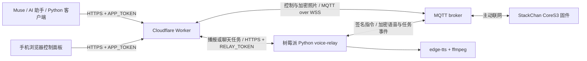

# StackChan 云端操控：让 Muse 远程指挥你的桌面机器人

人在外，Muse 在云端，StackChan 在桌上。这套方案让 Muse 或任何能调用 HTTPS 的 AI 助手远程**拍照、转头、点头、调节音量和亮度，并让机器人朗读助手的回复原文**。手机也可以直接打开自带控制面板。

机器人主动连接 MQTT，不需要家里公网 IP 或路由器端口映射。Cloudflare Worker 提供统一 HTTPS API；回复播报另由常开的树莓派完成 TTS 合成。部署完成后，Windows 电脑可以关机。

## 架构



**控制和拍照不经过树莓派；播报与文字聊天需要树莓派。** `firmware/` 是刷入 ESP32-S3 的 C++ 固件，`voice-relay/` 才是树莓派上的 Python 服务。当前方案仍使用公共 MQTT broker；换成 Tailscale Funnel 只解决语音服务的 HTTPS 入口，没有消除 MQTT 依赖。

## 功能

| 能力 | 接口 | 说明 |
|---|---|---|
| 状态 | `POST /api/status` | 设备状态、姿态、音量和亮度；超时不等于明确离线 |
| 转头 | `POST /api/head` | yaw −128～128°，日常 pitch 5～85° |
| 手势 | `POST /api/gesture` | nod / shake / tilt / center / release |
| 设置 | `POST /api/volume`、`POST /api/brightness` | 音量 0～100；亮度 5～100 |
| 拍照 | `POST /api/photo` | 完整 JPEG 字节流，支持无 body POST 与 `{}` |
| Muse 回复播报 | `POST /api/speak` | 朗读传入原文，不重新生成答案；支持幂等与取消 |
| 小智文字聊天 | `POST /api/chat` | 将文字转成语音输入机器人，小智生成自己的回复 |

## 目录

```text
firmware/       完整 CoreS3 固件源码、分区表、ESP-IDF 构建配置
worker/         Cloudflare Worker、Durable Object、网页控制面板与测试
voice-relay/    TTS 合成、语音任务、MQTT 传输、systemd 安装器与测试
client/         Muse 提供的 Python 命令行客户端与回归测试
docs/           API、Muse 接入、部署与安全说明
```

## 快速开始

硬件以 **M5Stack CoreS3 / ESP32-S3、16 MiB Flash 的 StackChan** 为适配目标。不同板型不能直接使用相同构建与刷写地址。

1. [构建并刷入固件](firmware/README.md)：安装 ESP-IDF 5.5.2，生成独立设备控制密钥，构建、备份并刷写；完成 Wi-Fi 配网。不要使用本人的已编译镜像，仓库只发布源码。
2. [部署 Worker](worker/README.md)：`npm ci`，通过 `wrangler secret put` 设置 `APP_TOKEN`、`DEVICE_CONTROL_SECRET` 和 `ROBOT_MAC`，再 `npm run deploy`。这时即可控制和拍照。
3. [部署语音中转](voice-relay/README.md)：在树莓派安装 Python 服务，配置同一设备密钥与 MAC，经有效 HTTPS 入口供 Worker 调用；设置 Worker 的 `RELAY_URL` 和 `RELAY_TOKEN`。
4. 把 Worker 地址、APP_TOKEN 和 [Muse 调用说明](docs/MUSE.md) 私下交给 Muse。OpenAPI 可使用 [docs/openapi-speak.json](docs/openapi-speak.json)，先替换 servers 中的占位地址。

```bash
export STACKCHAN_GATEWAY="https://<你的worker>.workers.dev"
export STACKCHAN_TOKEN="<你的APP_TOKEN>"
python3 client/stackchan_client.py status
python3 client/stackchan_client.py head --yaw -60 --pitch 20
python3 client/stackchan_client.py photo --output snap.jpg
python3 client/stackchan_client.py speak --text "你好，这是 Muse 的回复。" --key muse_reply_001
python3 client/stackchan_client.py volume --value 30
```

PowerShell 使用 `$env:STACKCHAN_GATEWAY='https://<你的worker>.workers.dev'` 和 `$env:STACKCHAN_TOKEN='<你的APP_TOKEN>'` 设置环境变量。手机打开 Worker 根网址，填入令牌后使用面板；不要把令牌放入分享链接。

## 费用与运行限制

- Cloudflare **Workers Free** 支持本项目使用的 SQLite Durable Objects；免费额度有上限，超限与服务可用性请以 [Workers 定价](https://developers.cloudflare.com/workers/platform/pricing/) 和 [Durable Objects 限制](https://developers.cloudflare.com/durable-objects/platform/limits/) 为准。免费计划不意味着无限请求或可用性保证。
- 语音合成不在 Worker 中运行。需要已有树莓派或其他常开 Linux 主机、网络和供电；edge-tts 是外部在线语音服务，也有可用性限制。
- 默认公共 MQTT 用于个人实验，可能断连或被旁人监听流量。设备控制有 HMAC；照片和语音任务使用应用层加密，但传统状态/控制 ACK 不具有同等认证保证。详见 [安全说明](docs/SECURITY.md)。
- 聊天与播报互斥，忙碌返回 409；当前不支持无限排队。播报 1～1000 个 Unicode 码点，合成音频上限 120 秒。分段后等待上一段 `settled: true`。
- 拍照客户端建议总超时至少 35 秒，一次一张；收到 JPEG 后才视为成功。不要在不确定是否执行时盲目重复运动指令。

## 验证与已知差异

当前发布副本来自已有控制、加密拍照及原文播报实现。2026-09-30 的本地设备验收记录显示播报完成、取消后恢复待机，以及拍照回归通过；这些是历史运行证据，不代表每个新部署都已验收，也不代替听音确认。

在新部署上应依次检查：无令牌返回 401 → 设备状态成功 → 收到完整 JPEG → 提交短播报并轮询 `done` 且 `settled: true` → 实际听音 → 测试取消 → 关闭 Windows 后重试。详见 [验证说明](docs/VALIDATION.md)。

Muse ZIP 的客户端保留了拍照的无 body POST。此次仅修正 `api()` 的 GET 参数透传，使 chat/speak 轮询可用；原文件完整保存于 [docs/muse-original/stackchan_client.py](docs/muse-original/stackchan_client.py)。ZIP 中“所有 Cloudflare 都必须浏览器 UA”“JSON 拍照必定超时”“拍照已不依赖 MQTT”等说法不适用于当前源码，已在文档中纠正。客户端中相关旧注释保留供对照，应以这里和 API 文档为准。

## 开源协议与来源

MIT，见 [LICENSE](LICENSE)。固件基于 [LucaZhang7784/stackchan-fusion](https://github.com/LucaZhang7784/stackchan-fusion) 和小智生态；保留 [固件原 MIT 声明](firmware/LICENSE)。依赖组件仍遵守各自许可证。Muse 提供初始分享骨架与 Python 客户端，Codex 协助整理本地固件、网关和语音中转实现。详见 [THIRD_PARTY_NOTICES.md](THIRD_PARTY_NOTICES.md)。
